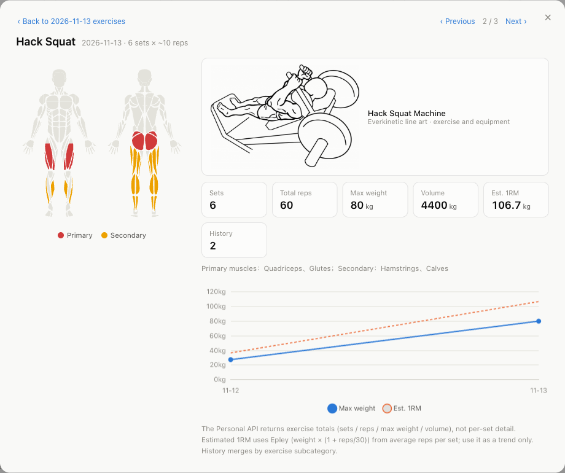

# Garmin Training & Health Dashboard

Pull your own Garmin Connect data (activities, sleep, HRV, weight) into a local SQLite file and
generate a **single-file, offline** dashboard. Everyone uses their own Garmin account and
Personal API Key; nothing is uploaded to a server.

**English | [中文](README.zh-CN.md)**



> The screenshot uses the author's 2026-11-13 training record for demonstration; it contains no
> name, account ID or device ID.

## What you get

- **Training load & recovery**: CTL (42 d) / ATL (7 d) / TSB, acute:chronic ratio (ACWR), with
  90/180/365-day windows
- **Training detail**: weekly muscle coverage (body diagram + effective-set ranges), training-day
  cards, exercise detail (muscle map / equipment line art / estimated 1RM / history), raw table
- **Sleep need × training**: need vs actual, sleep-midpoint drift, training end → bedtime,
  previous sleep/HRV → next-day load
- **Daily health**: steps, Body Battery, sleep structure/score, resting HR, HRV, stress, SpO2,
  cycling, weight, daily table
- **Advice**: 12 data-driven rules plus a weekly coverage review, each with its basis

## Requirements

- Python **3.10+** (standard library only)
- A Garmin Connect account (international `.com` or China `.cn`)
- Internet access; from mainland China the `.com` endpoint may need a proxy

## First run

```bash
python3 setup.py
```

The wizard:

1. asks your region (international `.com` / China `.cn`)
2. opens the Garmin Personal API page and lets you paste the key (hidden input)
3. exchanges the key for a 24-hour token and validates it
4. syncs the last 90 days
5. builds `reports/dashboard.html` and opens it

**How to get the key, region rules and 404/401 fixes:** see [API.md](API.md).

## Daily use

```bash
python3 garmin.py sync --days 7     # incremental
python3 garmin.py dashboard         # rebuild the dashboard
```

Other commands:

```bash
python3 garmin.py status            # DB status / last sync
python3 garmin.py report            # last 7 days as Markdown
python3 garmin.py backfill          # one-off activity backfill since 2019
```

## Where the data lives

| Directory | Contents |
|---|---|
| `data/garmin.db` | SQLite with raw and parsed tables |
| `fit/` | FIT files archived by `sync --fit` |
| `reports/` | generated dashboard and reports |

All three are in `.gitignore` and **never committed**. The data stays on your machine; the
dashboard is a static file and does not upload anything.

Keys and tokens are also outside the repository:

```
~/.config/garmin/personal_api_key.<com|cn>.txt
~/.config/garmin/token_cache.json
```

## Configuration

Data defaults to the package directory; override with environment variables:

| Variable | Meaning |
|---|---|
| `GARMIN_REGION` | `com` (international) or `cn` (China) |
| `GARMIN_LANG` | `zh` or `en` (default: system locale, fallback zh) |
| `GARMIN_HOME` | data/report root (default: package directory) |
| `GARMIN_KEY_FILE` | key file path |
| `GARMIN_TOKEN_CACHE` | token cache path |

Examples:

```bash
GARMIN_REGION=cn python3 garmin.py sync --days 30
GARMIN_LANG=en python3 garmin.py dashboard
```

## Use as a Claude Code skill

Copy the whole folder to `~/.claude/skills/garmin-dashboard/`, then ask Claude
"sync my Garmin data" or "build my Garmin dashboard". `SKILL.md` guides the first setup.
Without Claude Code, just run `python3 setup.py`.

## Caveats

- **Training load** is Garmin `activityTrainingLoad`, suitable for relative trends only; it is not
  an absolute TSS.
- **Strength detail** comes from sets recorded on the watch; sets you did not log are missing.
- **Sleep times** are recomputed from raw GMT timestamps; Garmin's `sleepStartTimestampLocal` is a
  wall-clock value encoded as UTC and is 8 hours off if converted naively.
- The **body diagram** uses MuscleMap paths; the three deltoid heads and glute max/medius share one
  visual region (statistics are still separate).
- **Weekly coverage advice** needs 3–4 weeks of records to stabilise.
- The Personal API is read-only and only returns your own data. Garmin does not publish a rate
  limit; the script throttles to 0.35 s and uses 4 threads for sleep.

## Troubleshooting

| Symptom | Fix |
|---|---|
| `404 Personal API Key with ID … does not exist` | wrong region; try `.com` / `.cn` |
| `401` | key incomplete or expired; generate a new one |
| No data | make sure the watch has synced to Garmin Connect; check the account region |
| `.com` unreachable from mainland China | configure a proxy, or use a `.cn` account |
| Dashboard won't open | double-click `reports/dashboard.html`; Chart.js is inlined |

## License

Code is MIT. Third-party assets:

- Body diagram: [MuscleMap](https://github.com/melihcolpan/MuscleMap) (MIT)
- Exercise line art: [Everkinetic](https://github.com/JAlbertoGonzalez/everkinetic-data) (CC BY-SA 3.0)
- Charts: [Chart.js](https://www.chartjs.org/) (MIT)

See [CREDITS.md](CREDITS.md). Keep the attributions when sharing; Everkinetic images must remain
under CC BY-SA 3.0.
