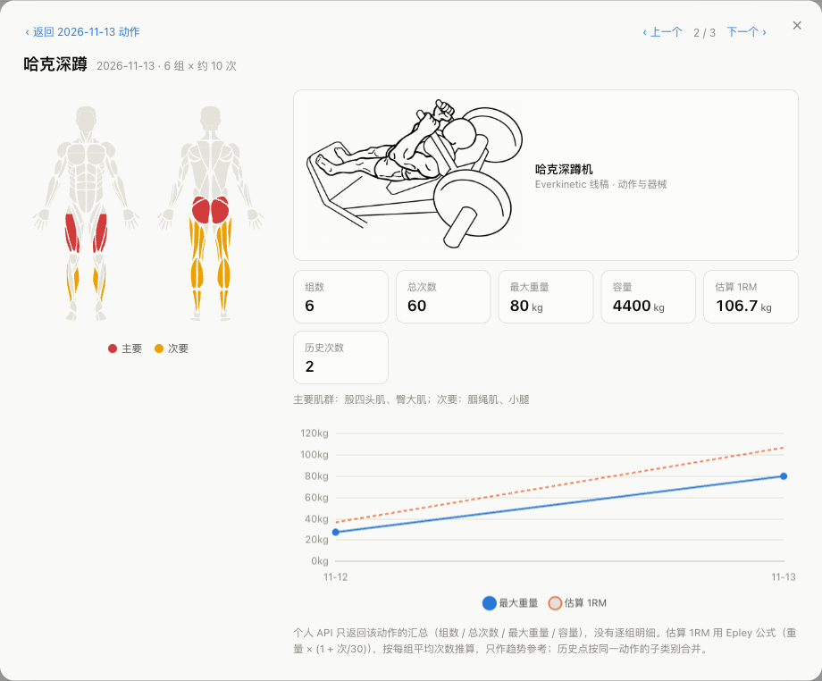

# Garmin 训练与健康看板

把 Garmin Connect 的个人数据（活动、睡眠、HRV、体重等）拉到本机 SQLite，生成**单文件、离线可用**的分析看板。
每个人用自己的 Garmin 账号和 Personal API Key，数据不上传任何服务器。



> 截图使用作者本人的 2026-11-13 训练记录，仅作展示；不含姓名、账号或设备 ID。

## 能看什么

- **训练负荷与恢复**：CTL（42 天）/ ATL（7 天）/ TSB、急慢性负荷比 ACWR，支持 90/180/365 天
- **训练明细**：本周部位覆盖（人体肌肉图 + 有效组区间）、训练日卡片、动作详情
  （肌肉图 / 器械线稿 / 估算 1RM / 历史趋势）、原始逐行表格
- **睡眠需求 × 训练**：睡眠需求 vs 实际、作息中点漂移、训练结束→入睡、前夜睡眠/HRV→次日负荷
- **日常健康**：步数、Body Battery、睡眠结构/评分、静息心率、HRV、压力、血氧、骑行、体重、逐日明细
- **建议**：从数据里推的 12 条规则 + 每周部位覆盖建议，每条带判断依据

## 环境要求

- Python **3.10+**（不需要安装第三方库）
- 一个 Garmin Connect 账号（国际区 `.com` 或中国区 `.cn`）
- 有网络；中国大陆访问 `.com` 端点可能需要代理（脚本本身不带代理配置）

## 第一次使用

```bash
python3 setup.py
```

向导会依次做：

1. 选账号区域（国际区 `.com` / 中国区 `.cn`）
2. 打开 Garmin 个人 API 页面，你把 Key 粘贴进来（输入不回显）
3. 用 Key 换 24 小时 token，验证是否可用
4. 拉取最近 90 天数据
5. 生成 `reports/dashboard.html` 并打开

**Key 怎么申请、区域怎么选、404/401 怎么排**，见 [API申请.md](API申请.md)。

## 日常更新

```bash
python3 garmin.py sync --days 7     # 增量拉最近 7 天
python3 garmin.py dashboard         # 重新生成看板
```

其他命令：

```bash
python3 garmin.py status            # 库状态、最后同步
python3 garmin.py report            # 最近 7 天周报（Markdown）
python3 garmin.py backfill          # 一次性回填 2019 年以来的活动列表
```

## 数据放在哪

| 目录 | 内容 |
|---|---|
| `data/garmin.db` | SQLite，全部原始数据与解析后的表 |
| `fit/` | `sync --fit` 时归档的 FIT 原始文件 |
| `reports/` | 生成的看板与周报 |

这三个目录都在 `.gitignore` 里，**不会进 git**。数据只在本机，页面是静态文件，不上传。

密钥与 token 也不在仓库里：

```
~/.config/garmin/personal_api_key.<com|cn>.txt
~/.config/garmin/token_cache.json
```

## 配置

默认数据目录在包内；可用环境变量覆盖：

| 变量 | 作用 |
|---|---|
| `GARMIN_REGION` | `com` 国际区 / `cn` 中国区 |
| `GARMIN_HOME` | 数据与报告根目录（默认包目录） |
| `GARMIN_KEY_FILE` | 密钥文件路径 |
| `GARMIN_TOKEN_CACHE` | token 缓存路径 |

例：

```bash
GARMIN_REGION=cn python3 garmin.py sync --days 30
```

## 作为 Claude Code Skill 使用

把整个文件夹复制到 `~/.claude/skills/garmin-dashboard/`，然后对 Claude 说
“同步我的 Garmin 数据”或“生成 Garmin 看板”即可。`SKILL.md` 会引导首次配置。
不用 Claude Code 的话，直接按上面的 `python3 setup.py` 用。

## 口径与限制

- **训练负荷**用 Garmin 的 `activityTrainingLoad`，只适合看相对趋势，不能和功率 TSS 的绝对值比较。
- **力量动作**来自手表上按组记录的部分；没在表上按下的组不会出现。
- **睡眠时间**从 raw 的 GMT 时间戳重算；Garmin 的 `sleepStartTimestampLocal` 是“墙上时间当 UTC 编码”，
  直接按本地时区转会多 8 小时。
- **肌肉图**基于 MuscleMap 的解剖路径；三角肌前/中/后束、臀大肌/臀中肌在图上共用整块。
- **周覆盖建议**需要连续记录 3–4 周才稳定；只有几次训练时先当观察用。
- 个人 API 只读、只能拉本人数据；官方未公布限流阈值，脚本已做 0.35 秒节流 + 睡眠 4 线程。

## 排障

| 现象 | 处理 |
|---|---|
| `404 Personal API Key with ID … does not exist` | 区域配错，换 `.com` / `.cn` |
| `401` | Key 复制不全或失效，回设置页重新生成 |
| 拉不到数据 | 确认手表已同步到 Garmin Connect；确认账号区域 |
| 中国大陆连不上 `.com` | 给终端配代理，或改用 `.cn` 账号 |
| 看板打不开 | 直接双击 `reports/dashboard.html`；Chart.js 已内联 |

## 许可

代码 MIT。第三方素材：

- 人体肌肉图：[MuscleMap](https://github.com/melihcolpan/MuscleMap)（MIT）
- 动作线稿：[Everkinetic](https://github.com/JAlbertoGonzalez/everkinetic-data)（CC BY-SA 3.0）
- 图表：[Chart.js](https://www.chartjs.org/)（MIT）

详见 [CREDITS.md](CREDITS.md)。对外分享时请保留这些署名；Everkinetic 图片需按 CC BY-SA 3.0 同协议共享。
